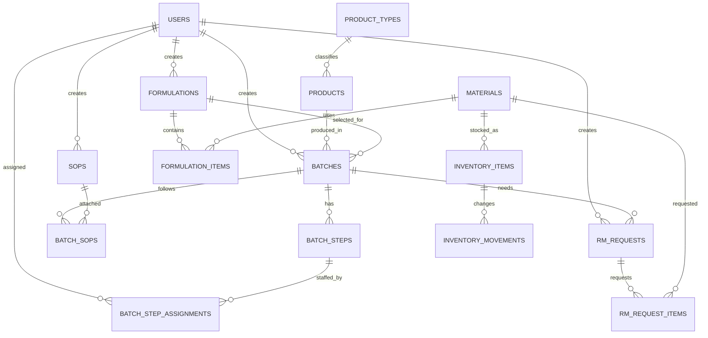

# Database Design

This design is derived from the supplied UX screens. PostgreSQL is the source of truth; API queries should remain explicit raw SQL through `pg-promise`.

## Core relationships



## Tables

- `users`: existing authenticated accounts. `password_hash` comes from migration 002.
- `product_types`, `products`: product dropdowns and batch metadata.
- `materials`: raw materials and packaging inputs, including specification and display unit.
- `formulations`: named versions owned by a creator.
- `formulation_items`: ordered material recipe lines. `process_stage` supports sections such as Dry Mixing, Lubrication, and Coating; `quantity`, `overage_percent`, and `unit` support the detail table.
- `sops`: SOP library content and metadata shown on the detail page.
- `batches`: batch number, product, dates, optional formulation, and lifecycle status.
- `batch_sops`: many-to-many SOP selection when creating a batch.
- `batch_steps`: process steps such as Granulation, Compression, and Coating.
- `batch_step_assignments`: operators and helpers assigned to each step.
- `inventory_items`: current material balance for the inventory table.
- `inventory_movements`: append-only audit trail for Item In, Item Out, reservations, and releases. Inventory writes should update the balance and insert the movement in one transaction.
- `rm_requests`: generated material request header linked to a batch and its store processing status.
- `rm_request_items`: selected material lines, requested quantity, fulfilled quantity, unit, and availability checks.

## Workflow decisions

1. A formulation is reusable; a batch stores the selected formulation reference. If formulations become versioned, add a `version` column and make `(name, version)` unique.
2. `material_id` is used instead of copying names into recipes and requests, preventing spelling drift across inventory and formulation screens.
3. Units are stored on transaction lines as snapshots. This preserves historical display values if a material's default unit changes later.
4. Inventory quantity must never be changed without an `inventory_movements` row. Item In increases the balance; Item Out and fulfilled RM requests decrease it.
5. RM request completion, rejection, processor, and timestamps are stored on the request header. Rejection requires a reason.
6. Operators and helpers reuse `users`; the `role` column allows one person to have different roles on different process steps.
7. The migration uses `ON DELETE CASCADE` only for owned child rows and keeps reference data such as materials, products, and SOPs protected from accidental deletion.

## Migration

Apply with:

```bash
pnpm migrate:up
```

Rollback the entire manufacturing schema with:

```bash
pnpm migrate:down
```

Migration file: `apps/api/migrations/003_create_manufacturing_schema.sql`.
